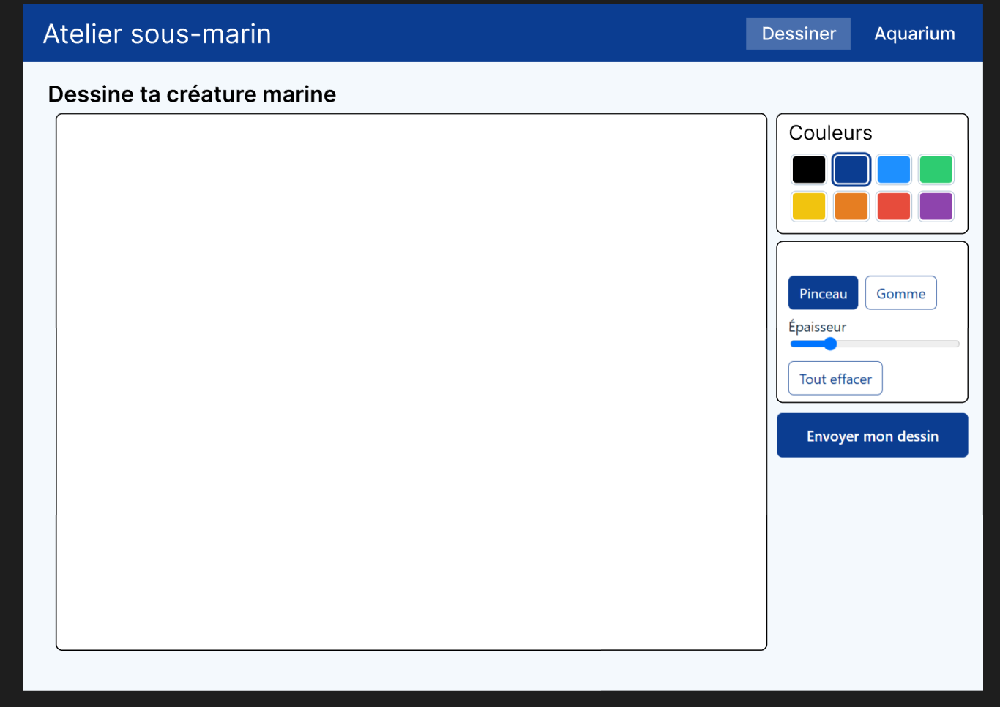
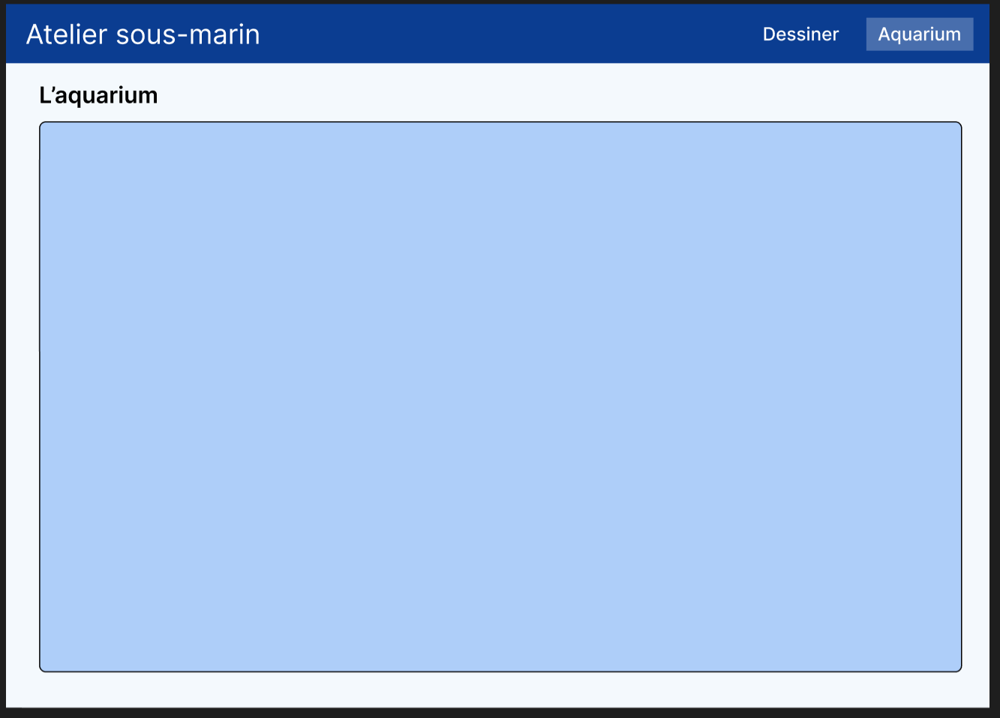

# Atelier sous-marin animé

[](https://github.com/Xhealia/Projet-Festival/actions/workflows/ci.yml)

**Démo en ligne : http://84.235.237.39:8080/**

## C'est quoi ?

Une application web de **deux pages** :

1. **Dessiner** : le visiteur dessine un sous-marin ou une créature marine sur un canevas (couleurs, pinceau, gomme, épaisseur).
2. **Aquarium** : tous les dessins acceptés nagent dans un aquarium animé.

Entre les deux, chaque dessin est envoyé à une **API de modération** (Sightengine) qui vérifie qu'il ne contient pas de contenu explicite, de symboles haineux ou de texte insultant. Un dessin refusé n'est jamais enregistré.

## Accès au POC (serveur)

| | |
|---|---|
| **Adresse** | http://84.235.237.39:8080/ |
| **Utilisation** | Ouvrir l'adresse, dessiner, cliquer sur « Envoyer mon dessin », puis ouvrir la page « Aquarium » |
| **Hébergement** | Serveur gratuit, application lancée avec Docker Compose (2 conteneurs : `client` et `server`) |
| **Relancer l'application** (sur le serveur) | `cd Projet-Festival && docker compose up -d --build` |

## Design

Le design général (wireframes, maquette, choix ergonomiques, test avec des utilisateurs) est expliqué dans **[docs/design/README.md](docs/design/README.md)**.

## Architecture : deux services indépendants

```
Navigateur
   |
   v
+-------------------+   /api, /uploads   +--------------------+   check.json   +------------------+
| SERVICE 1 : client | -----------------> | SERVICE 2 : server  | -------------> | API Sightengine  |
| React + Vite       |                    | Node.js + Express   |                | (service externe)|
| servi par Nginx    | <----------------- | stocke les dessins  | <------------- |                  |
+-------------------+  201 / 422 / 503   +--------------------+     scores     +------------------+
```

| Service | Dossier | Rôle | Dockerfile | Tests |
|---|---|---|---|---|
| **IHM** (interface) | `client/` | Affiche les deux pages, dessine, envoie le dessin | oui | lint + build |
| **API** | `server/` | Reçoit le dessin, le fait modérer, l'enregistre, liste les dessins | oui | `npm test` (Vitest) |

Les deux services ont chacun leur `package.json`, leur `Dockerfile` et tournent dans des conteneurs séparés. Ils ne communiquent que par HTTP (Nginx redirige `/api` et `/uploads` vers le service API).

**Pourquoi un seul dépôt Git (monorepo) ?** Les deux services évoluent ensemble (une modification de l'API touche souvent l'interface). Un seul dépôt donne un seul historique, une seule CI et un seul déploiement, tout en gardant les deux services séparés dans leurs dossiers.

### Design pattern

| Couche | Rôle | Fichiers |
|---|---|---|
| **Pages** (contrôleurs) | Gèrent l'état et les actions de l'utilisateur | `client/src/pages/DrawPage.jsx`, `AquariumPage.jsx` |
| **Composants** (vues) | Affichent, sans logique métier | `DrawingCanvas`, `ColorPalette`, `ToolPanel`, `Aquarium`, `NavBar` |
| **Accès API** | Seul endroit qui appelle le serveur | `client/src/api.js` |
| **Routes** (serveur) | Reçoivent les requêtes HTTP et valident le fichier | `server/src/routes/drawings.js` |
| **Service de modération** | Appelle Sightengine, renvoie un verdict | `server/src/moderation.js` |

Le service de modération est **injecté** dans l'application (`createApp({ moderate })`) : les tests le remplacent par une fonction simulée, sans appeler le service externe.

### API du serveur

| Méthode | Route | Rôle | Réponses |
|---|---|---|---|
| GET | `/api/health` | Vérifier que le serveur tourne | 200 |
| POST | `/api/drawings` | Envoyer un dessin (champ `image`, PNG, 5 Mo max) | 201 accepté, 422 refusé, 400 fichier invalide, 503 modération indisponible |
| GET | `/api/drawings` | Lister les dessins acceptés | 200 |

**Règle de sécurité (fail-closed)** : si l'API de modération est injoignable ou le quota dépassé, le serveur répond 503 et refuse le dessin. Un dessin non vérifié n'est jamais publié.

### Pas d'API bouchon

Le prototype appelle directement la vraie API de modération. Il n'y a pas de simulation (« bouchon ») : le prototype est donc testé dans des conditions réelles. Seuls les tests automatiques utilisent une modération simulée, pour ne pas consommer le quota gratuit.

## Choix du framework

| Outil | Pourquoi |
|---|---|
| **React** (avec Vite) | Découpe l'interface en composants réutilisables (canevas, palette, aquarium) et met l'écran à jour facilement. Très utilisé, donc beaucoup d'aide en ligne. React Router gère les deux pages. |
| **Node.js + Express** | Même langage (JavaScript) pour le front et le back. Express est minimaliste : trois routes suffisent. |
| **Docker** | Le projet se lance de la même façon sur n'importe quelle machine, avec une seule commande. |

## Preuves de fonctionnement et tests

**Tests automatiques** : `cd server && npm install && npm test`. Ils vérifient qu'un bon dessin est accepté, qu'un dessin signalé est refusé et non enregistré, et que le serveur refuse tout si la modération est en panne.

**Tests faits à la main sur la démo en ligne :**

| Dessin | Résultat attendu | Résultat obtenu |
|---|---|---|
| Méduse | Accepté | Accepté (score 0,001) |
| Croquis explicite | Refusé | Refusé (score 0,99) |

**Comparaison avec une autre API** : sur le même croquis explicite, l'API localmod donnait un score de 0,0016 (dessin jugé normal, donc non détecté), alors que Sightengine donne 0,99 (bloqué). C'est pour cela que Sightengine a été retenue.

**Captures d'écran :**




## CI/CD (automatisation)

À chaque `git push`, GitHub lance automatiquement la **CI** (fichier `.github/workflows/ci.yml`) :

1. Il lance les tests du serveur.
2. Il vérifie et compile le code du client.
3. Il construit les images Docker.

**CD (déploiement automatique)** : quand la CI réussit, un second fichier (`.github/workflows/deploy.yml`) se connecte au serveur et met à jour l'application. Il utilise trois secrets GitHub : `SERVER_HOST`, `SERVER_USER` et `SERVER_SSH_KEY`.

## Limites

- Les modèles de modération sont surtout entraînés sur des photos : un dessin très simple peut passer sans être détecté.
- La lecture de texte écrit à la souris peut échouer : un mot mal tracé peut ne pas être reconnu.
- Les dessins sont envoyés à un service extérieur (Sightengine).
- Le plan gratuit a un quota : si on le dépasse, les dessins sont refusés. Il n'y a pas de limite du nombre d'envois par personne.